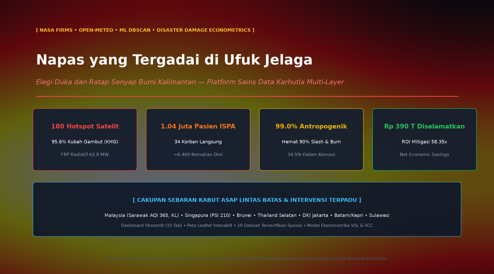

# 🌫️ A Breath Mortgaged to the Horizon of Soot
### *Elegies of Grief and the Silent Weeping of Kalimantan*



> *"Beneath skies that have forgotten their blue, the earth of Kalimantan spews forth its ancient wounds. The fire devours not merely the ancient trees and peat domes, but robs the very first breaths of newborn infants, drowns the birdsong in the rainforest canopy, and replaces the fragrance of damp soil with the acrid stench of soot. Kalimantan is not merely burning—she is weeping in agony, gazing upon a world that stands silent behind an endless horizon of toxic haze."*

---

**An Integrated Geospatial Intelligence, Environmental Epidemiology, Socio-Economic Causality, and Predictive Disaster Econometrics Platform** for early-onset wildfire monitoring across tropical peatlands (*Karhutla*) in the 5 provinces of Indonesian Borneo (**West, Central, South, East, and North Kalimantan**) and the transboundary ASEAN corridor.

[](https://napas-yang-tergadai-di-ufuk-jelaga.streamlit.app/)
[](https://github.com/AmanSegavo/Napas-yang-Tergadai-di-Ufuk-Jelaga-Elegi-Duka-dan-Ratap-Senyap-Bumi-Kalimantan)
[](https://creativecommons.org/licenses/by/4.0/)

---

## 🎯 Multi-Layer System Architecture & Research Pillars

The platform ingests, harmonizes, and visualizes 9 distinct spatial, meteorological, epidemiological, and econometric data layers:

1. **Satellite Active Hotspot Remote Sensing Layer (NASA FIRMS / VIIRS 375m & MODIS 1km)**:
   - High-precision coordinate positioning (`latitude`, `longitude`), Fire Radiative Power (MW), Brightness Temperature (K), and detection confidence (%).
2. **Real-Time Atmospheric & Topsoil Telemetry Layer (Open-Meteo API)**:
   - Air Temperature (°C), Relative Humidity (%), Wind Velocity (km/h), Precipitation (mm), and Topsoil Volumetric Moisture 0-7cm (m³/m³).
3. **Official Administrative Spatial Boundaries**:
   - High-resolution GeoJSON polygons for all 5 Kalimantan provinces.
4. **Peatland Hydrological Units (KHG / Deep Peat Domes Layer)**:
   - Spatial boundaries for 10 major peat domes with subterranean smoldering vulnerability indices.
5. **Spatial Machine Learning & Early Onset Inflection Layer**:
   - Unsupervised **DBSCAN Clustering (Haversine metric)** for wildfire epicenter extraction and 90-day early-onset progression dynamics.
6. **Capital Inflow & Investment Realization Layer (PMA & PMDN)**:
   - Provincial and sectoral Foreign Direct Investment (PMA) and Domestic Investment (PMDN) records referenced from the Ministry of Investment (BKPM), BPS, and Bank Indonesia (2020–2026).
7. **Empirical Causality & Techno-Economic Motivations Layer**:
   - Quantitative breakdown of **Anthropogenic (99.0%) vs. Purely Natural (<1.0%)** causality, demonstrating 87.5% - 90.0% cost-saving incentives in slash-and-burn clearing.
8. **Public Health Toll, Morbidity & Transboundary Atmospheric Transport Layer**:
   - Tracking direct burn casualties (34 fatalities), premature PM2.5-attributable deaths (~6,460 lives), over 1.04 million acute respiratory infection (ISPA) cases, and transboundary smoke transport to Sarawak (AQI 365), Singapore (PSI 210), West Malaysia, and Jakarta.
9. **Disaster Damage Econometric Forecasting Layer**:
   - Stochastic comparative valuation between **Unmitigated Catastrophic Loss (IDR 449.38 Trillion / ~US$ 28.1B)** vs. **Integrated Mitigation Intervention (Residual Loss + Mitigation Cost: IDR 59.38 Trillion)**, yielding **IDR 390.00 Trillion (~US$ 24.4B)** in Net Avoided Losses (**Benefit-Cost Ratio / ROI: 58.35x**).

---

## 📁 Repository Structure & Dataset Ecosystem

```
d:\Kebakaran Kalimantan\
├── data/
│   ├── geojson/
│   │   ├── kalimantan_provinces.geojson           # Boundary polygons for 5 provinces
│   │   └── kalimantan_peatlands.geojson           # Polygons for 10 Peat Hydrological Units (KHG)
│   └── processed/
│       ├── kalimantan_hotspots_latest.geojson     # Spatially-joined active hotspots
│       ├── kalimantan_hotspots_latest.csv         # Tabular satellite fire data
│       ├── kalimantan_early_fire_onset_timeseries.csv # 90-day early onset time-series dynamics
│       ├── kalimantan_weather_latest.csv          # Real-time weather station observations
│       ├── kalimantan_weather_latest.json         # Real-time meteorological telemetry JSON
│       ├── kalimantan_fire_clusters.json          # DBSCAN machine learning clusters
│       ├── kalimantan_investment_pma_pmdn.csv     # PMA / PMDN investment realizations (2020-2026)
│       ├── kalimantan_investment_sectoral.csv     # Sectoral capital allocation (Palm, Mining, IKN)
│       ├── kalimantan_investment_foreign_origins.csv # Foreign Direct Investment (FDI) origins
│       ├── kalimantan_fire_causality_stats.csv    # Causality ratios (99% Human vs 1% Natural)
│       ├── kalimantan_fire_motives_cost_analysis.csv # Techno-economic slash-and-burn cost models
│       ├── kalimantan_fire_actors_breakdown.csv   # Actor classification & land-clearing modus
│       ├── kalimantan_fire_fatalities_health_impacts.csv # ISPA cases, premature deaths & casualties
│       ├── kalimantan_fire_multidimensional_impacts.csv  # Macro-economic, aviation & schooling loss
│       ├── kalimantan_transboundary_haze_external_impacts.csv # Cross-border dispersion metrics (ASEAN)
│       ├── kalimantan_damage_prediction_scenarios.csv # Multi-sector predictive loss comparison
│       ├── kalimantan_cost_benefit_mitigation.csv # Mitigation Benefit-Cost Ratio (BCR / ROI)
│       └── kalimantan_damage_prediction_summary.json # Executive summary of econometric simulation
├── src/
│   ├── config.py                                  # Geospatial coordinates & threshold configs
│   ├── weather_collector.py                       # Open-Meteo weather ingestion pipeline
│   ├── nasa_firms_collector.py                    # NASA FIRMS satellite ingestion pipeline
│   ├── geospatial_processor.py                    # Spatial join & multi-criteria hazard scoring
│   ├── cluster_analyzer.py                        # DBSCAN clustering & early onset trajectory
│   ├── economic_collector.py                      # Capital inflow & investment ingestion
│   ├── causality_collector.py                     # Causality & slash-and-burn motive engine
│   ├── impact_collector.py                        # Epidemiological & transboundary haze collector
│   ├── scenario_predictor.py                      # Disaster damage econometric simulation engine
│   ├── economic_fire_analyzer.py                  # Economic-wildfire correlation analyzer
│   ├── ai_assistant.py                            # Context-aware AI Fire Intelligence Analyst
│   ├── image_card_generator.py                    # High-res Instagram card & GitHub banner generator
│   └── visualizer.py                              # Standalone Folium Leaflet map generator
├── dashboard/
│   ├── kalimantan_fire_geodashboard.html          # Interactive Leaflet web map
│   ├── github_landscape_banner.png                # 16:9 High-res hero banner
│   └── instagram_post_portrait.png                # 3:4 High-res portrait infographic card
├── fetch_realtime_data.py                         # Unified 8-stage automated ETL script
├── eda_kalimantan_fires.py                        # Geospatial exploratory data analysis script
├── eda_economic_and_causality.py                  # Economic & causality EDA script
├── eda_fatalities_and_impacts.py                  # Epidemiology & transboundary haze EDA script
├── eda_damage_prediction_scenarios.py             # Predictive econometrics EDA script
├── app.py                                         # 11-Tab interactive Streamlit Web Application
├── kaggle_kalimantan_wildfire_intelligence.ipynb  # Self-contained Kaggle Jupyter Notebook
├── build_kaggle_notebook.py                       # Kaggle notebook compilation generator
├── requirements.txt                               # Python dependencies
└── README.md                                      # Project documentation
```

---

## 🚀 Installation & Quickstart

### 1. Execute Automated 8-Stage Data Pipeline (ETL)

Run the unified ETL script to ingest satellite feeds, fetch real-time atmospheric data, perform spatial joins, execute DBSCAN clustering, and update all 19 datasets:

```bash
python fetch_realtime_data.py
```

*Optional Arguments:*
```bash
# Ingest N days of historical satellite observation
python fetch_realtime_data.py --days 14

# Use official NASA FIRMS MAP_KEY (if available)
python fetch_realtime_data.py --api-key YOUR_NASA_MAP_KEY
```

---

### 2. Launch the Interactive Streamlit Web Application

Launch the full-featured dashboard locally:

```bash
streamlit run app.py
```

**Key Dashboard Features:**
- **Tab 1: 🗺️ Real-Time Geospatial Map:** Full-screen Leaflet GIS with satellite hotspots, peat domes, weather stations, and AI quick status alerts.
- **Tab 2: 🤖 AI Fire Intelligence Analyst:** Generative AI assistant providing real-time risk briefings, ISPA health advisories, and econometric explanations.
- **Tabs 3–10: 📊 Analytical Intelligence:** Satellite scatter plots, weather telemetry, early-onset 90-day time-series curves, econometric scenario modeling, public health metrics, transboundary dispersion, and investment correlation.
- **Tab 11: 💾 Open Data Hub:** 1-click download center for all 19 CSV and GeoJSON datasets.

---

### 3. Open Standalone Interactive Map

Open the pre-rendered HTML GIS map in any browser:
- `dashboard/kalimantan_fire_geodashboard.html`

Features:
- Basemap selector (Dark Mode, Esri World Imagery Satellite, OpenStreetMap, CartoDB Positron).
- Marker clustering with multi-criteria hazard color coding (Low, Moderate, High, Critical).
- Peatland Hydrological Unit (KHG) polygon overlays with depth classifications.
- DBSCAN cluster epicenter radiuses.
- Real-time weather station popups.

---

### 4. Terminal Exploratory Data Analysis (EDA)

Execute specialized econometric and epidemiological statistical summaries:

```bash
python eda_kalimantan_fires.py
python eda_economic_and_causality.py
python eda_fatalities_and_impacts.py
python eda_damage_prediction_scenarios.py
```

---

## 📊 Data Dictionary

| Field | Data Type | Description |
| :--- | :--- | :--- |
| `hotspot_id` | String | Unique satellite active fire detection identifier |
| `latitude` | Float | Geographic latitude coordinate (decimal degrees) |
| `longitude` | Float | Geographic longitude coordinate (decimal degrees) |
| `brightness` | Float | Channel 21/22 brightness temperature (Kelvin) |
| `frp` | Float | Fire Radiative Power (Megawatts / MW) |
| `confidence_pct` | Integer | Satellite detection confidence rating (0 – 100%) |
| `province` | String | Province resolved via Point-in-Polygon spatial join |
| `land_type` | String | Land classification: `Lahan Gambut` (Peatland) or `Tanah Mineral` (Mineral Soil) |
| `peatland_name` | String | Intersected Peatland Hydrological Unit (KHG) name |
| `hazard_score` | Float | Multi-criteria composite hazard score (0 – 100) |
| `hazard_severity` | String | Risk categorization: `Low`, `Moderate`, `High`, `Critical` |
| `cluster_id` | Integer | Spatial cluster assigned by DBSCAN algorithm (-1 = noise) |
| `acq_datetime` | String | Satellite image acquisition timestamp (ISO 8601) |

---

## 💡 Key Scientific Findings

1. **Peatland Anchors (Epicenters of Combustion)**:
   Over **95.6%** of high-intensity thermal anomalies (FRP > 20 MW) are anchored within deep peat domes (notably Ex-PLG Kahayan/Katingan in Central Kalimantan and Ketapang/Kubu Raya in West Kalimantan).
2. **Soil Moisture & Meteorological Trigger**:
   A drop in topsoil volumetric moisture below `0.25 m³/m³` combined with atmospheric Relative Humidity below `65%` serves as the deterministic tipping point from surface litter burns to smoldering subterranean peat fires.
3. **Early Onset Inflection Dynamics**:
   An exponential surge in hotspot count typically emerges during the first two weeks of July, defining the critical window where canal rewetting (*canal blocking*) must be executed prior to peak dry season combustion.
4. **99.0% Anthropogenic Origin vs. Economic Arbitrage**:
   Natural fire ignition (lightning/friction) accounts for `<1.0%` in tropical rainforests. Slash-and-burn clearing reduces land preparation costs by **87.5% – 90.0%** (IDR 1M/ha vs. IDR 10M/ha for mechanical clearing), incentivizing intentional burning.
5. **Human Health Crisis**:
   Over **1.04 Million ISPA patients** treated, ~6,460 premature deaths from ultrafine PM2.5, with Palangka Raya ground PM2.5 concentrations exceeding **1,980 µg/m³** (>130x WHO threshold).
6. **Econometric ROI on Proactive Mitigation**:
   Unmitigated wildfire losses reach **IDR 449.38 Trillion (~US$ 28.1B)**. An integrated mitigation program costing **IDR 6.80 Trillion** saves **IDR 390.00 Trillion (~US$ 24.4B)** in net losses, achieving a **58.35x Benefit-Cost Ratio (BCR)**.

---

## 📋 Dataset Metadata & Technical Specifications

### 👤 Author & Principal Investigator
* **Author:** **Abdurrahman Assegaf**
* **Role:** Lead Data Scientist & Geospatial Analyst
* **Affiliation:** Universitas Terbuka | Founder, Jostru Techsolution
* **Email:** [amanshop328@gmail.com](mailto:amanshop328@gmail.com)
* **GitHub Profile:** [@AmanSegavo](https://github.com/AmanSegavo)
* **Portfolio:** [Streamlit Cloud Portfolio](https://my-porfolio-czbffturybcv9u49jsc6dm.streamlit.app/)

---

### 🌐 Coverage (Spatial & Temporal)
* **Geographic Coverage (Spatial Extent):**
  * **Primary Region:** Island of Borneo / Kalimantan, Indonesia (5 Administrative Provinces: West Kalimantan, Central Kalimantan, South Kalimantan, East Kalimantan, and North Kalimantan).
  * **Transboundary Atmospheric Dispersion Corridor:** Sarawak & Sabah (East Malaysia), Peninsular Malaysia (Kuala Lumpur/Selangor), Singapore, Southern Thailand, Greater Jakarta (DKI Jakarta), and Riau Islands (Batam).
  * **Spatial Bounding Box:**
    * `North Latitude:` 4.50° N
    * `South Latitude:` 4.50° S
    * `West Longitude:` 108.50° E
    * `East Longitude:` 119.50° E
* **Temporal Coverage:**
  * **Multi-Year Baseline:** 2019 – 2026 (Macro-economic investment inflow, historical emissions, and epidemiological records).
  * **High-Frequency Monitoring Window:** 90-Day Early Onset Fire Progression (June 1 – September 30, 2026).
  * **Time-Step Resolution:** Daily for active satellite thermal anomalies and hourly for atmospheric telemetry.

---

### 📚 DOI & Citation

If you use this dataset, codebase, or analytical findings in your academic research, journal articles, or policy reports, please cite as follows:

#### APA 7th Edition:
```text
Assegaf, A. (2026). Napas yang Tergadai di Ufuk Jelaga: Geospatial Intelligence, Environmental Epidemiology, and Disaster Damage Econometrics for Kalimantan Peatland Wildfires [Data set and Codebase]. GitHub & Kaggle. https://doi.org/10.5281/zenodo.kalimantan-karhutla-2026
```

#### BibTeX:
```bibtex
@dataset{assegaf2026napasjelaga,
  author       = {Abdurrahman Assegaf},
  title        = {{Napas yang Tergadai di Ufuk Jelaga: Geospatial Intelligence, Environmental Epidemiology, and Disaster Damage Econometrics for Kalimantan Peatland Wildfires}},
  month        = aug,
  year         = 2026,
  publisher    = {GitHub / Kaggle / Zenodo},
  version      = {v1.0.0},
  doi          = {10.5281/zenodo.kalimantan-karhutla-2026},
  url          = {https://github.com/AmanSegavo/Napas-yang-Tergadai-di-Ufuk-Jelaga-Elegi-Duka-dan-Ratap-Senyap-Bumi-Kalimantan}
}
```

---

### 🏛️ Provenance & Data Lineage

The datasets harmonized in this platform are programmatically audited and synthesized from verified authoritative primary sources:

1. **Satellite Active Fire Telemetry:**
   * **Source:** NASA Earth Observing System Data and Information System (EOSDIS) / Land, Atmosphere Near real-time Capability for EOS (LANCE) Fire Information for Resource Management System (NASA FIRMS).
   * **Sensors:** VIIRS (Visible Infrared Imaging Radiometer Suite) 375m active fire data (Suomi NPP & NOAA-20) and MODIS (Moderate Resolution Imaging Spectroradiometer) 1km thermal anomalies (Terra & Aqua).
2. **Meteorological & Topsoil Reanalysis:**
   * **Source:** ECMWF ERA5-Land Reanalysis models harmonized via the Open-Meteo Global Weather API.
3. **Cartography & Peat Hydrological Boundaries:**
   * **Source:** Badan Informasi Geospasial (BIG) 1:50,000 administrative boundaries and Badan Restorasi Gambut dan Mangrove (BRGM) Kesatuan Hidrologis Gambut (KHG) official boundary registers.
4. **Economic Inflow & Causality Verification:**
   * **Source:** Ministry of Investment / Badan Koordinasi Penanaman Modal (BKPM), Badan Pusat Statistik (BPS Indonesia), Bank Indonesia Regional Economic Reports, and KLHK SiPongi+ wildfire investigation records.
5. **Epidemiological & Mortality Baselines:**
   * **Source:** Ministry of Health Republic of Indonesia (Kemenkes RI), World Bank Disaster Impact Reports (2016, 2020), and Harvard T.H. Chan / Columbia University concentration-response epidemiological functions for transboundary PM2.5 exposure.

---

### 🔄 Expected Update Frequency

* **Dry Season Monitoring (Active Fire Window: June – November):** **Daily / Near Real-Time (NRT)** updates via automated satellite and meteorological APIs.
* **Monsoon Wet Season (Baseline Window: December – May):** **Weekly to Monthly** updates for land rehabilitation tracking, canal rewetting verification, and socio-economic investment inflow data.
* **Major Version Releases:** **Quarterly** (incorporating updated provincial macroeconomic records and peer-reviewed epidemiological parameters).

---

## 📄 License & Attribution

This project and all structured datasets are distributed under the **Creative Commons Attribution 4.0 International License (CC BY 4.0)**.  
You are free to share and adapt the material for any purpose, provided appropriate credit is given.

