# 🗄️ ENTITY RELATIONSHIP DIAGRAM (ERD) & DATA ARCHITECTURE
### *Sistem Prediksi Spatiotemporal Karhutla Indonesia Berbasis Hotspot dan Cuaca*

---

## 📌 1. Diagram Konseptual & Logikal (Mermaid ERD)

```mermaid
erDiagram
    ADMINISTRATIVE_REGION ||--o{ GRID_CELL : "contains"
    PEATLAND_HYDROLOGICAL_UNIT ||--o{ GRID_CELL : "intersects"
    
    GRID_CELL ||--o{ RAW_HOTSPOT_DETECTION : "captures"
    GRID_CELL ||--o{ WEATHER_OBSERVATION : "measures"
    
    GRID_CELL ||--o{ SPATIOTEMPORAL_PANEL : "aggregates"
    WEATHER_OBSERVATION ||--o{ SPATIOTEMPORAL_PANEL : "features_derived_into"
    RAW_HOTSPOT_DETECTION ||--o{ SPATIOTEMPORAL_PANEL : "aggregated_into"
    
    SPATIOTEMPORAL_PANEL ||--o{ MODEL_PREDICTION : "evaluated_by"
    MODEL_REGISTRY ||--o{ MODEL_PREDICTION : "generates"
    
    GRID_CELL ||--o{ SOCIO_HEALTH_IMPACT : "suffers"
    MODEL_PREDICTION ||--o{ SOCIO_HEALTH_IMPACT : "estimates_losses_for"

    ADMINISTRATIVE_REGION {
        varchar province_id PK
        varchar province_name
        varchar island_name
        geometry boundary_polygon
    }

    PEATLAND_HYDROLOGICAL_UNIT {
        varchar khg_id PK
        varchar khg_name
        varchar depth_category
        float vulnerability_index
        geometry boundary_polygon
    }

    GRID_CELL {
        varchar cell_id PK
        varchar province_id FK
        varchar khg_id FK
        float centroid_lat
        float centroid_lon
        geometry grid_polygon
        float peatland_fraction
        varchar concession_type
        float distance_to_road_km
        float elevation_m
    }

    RAW_HOTSPOT_DETECTION {
        varchar hotspot_id PK
        varchar cell_id FK
        datetime acq_datetime
        varchar satellite_sensor
        float latitude
        float longitude
        float brightness_temp_k
        float frp_mw
        int confidence_score
    }

    WEATHER_OBSERVATION {
        varchar weather_id PK
        varchar cell_id FK
        date obs_date
        float temperature_2m_c
        float relative_humidity_pct
        float precipitation_mm
        float wind_speed_10m_kmh
        float soil_moisture_0_7cm
        float soil_moisture_7_28cm
        float spi_drought_index
    }

    SPATIOTEMPORAL_PANEL {
        varchar panel_id PK
        varchar cell_id FK
        varchar year_month
        int fire_count
        int fire_binary
        float total_frp_mw
        float temp_mean_c
        float precip_sum_mm
        float soil_moist_mean
        float lag1_precipitation
        float lag2_precipitation
        float lag1_soil_moisture
        int consecutive_dry_days
        float spatial_neighbor_fire_ratio
        int fire_next_1m_target
        int fire_next_3m_target
    }

    MODEL_REGISTRY {
        varchar model_id PK
        varchar model_name
        varchar algorithm_type
        varchar hyperparameter_json
        datetime trained_at
        float test_pr_auc
        float test_roc_auc
        float test_brier_score
    }

    MODEL_PREDICTION {
        varchar prediction_id PK
        varchar panel_id FK
        varchar model_id FK
        varchar forecast_period
        float predicted_probability
        float predicted_log_fire_count
        varchar hazard_severity_level
        datetime inference_timestamp
    }

    SOCIO_HEALTH_IMPACT {
        varchar impact_id PK
        varchar cell_id FK
        varchar forecast_period
        float estimated_pm25_ug_m3
        int projected_ispa_cases
        float unmitigated_loss_trillion_idr
        float avoided_loss_trillion_idr
    }
```

---

## 📋 2. Kamus Data & Spesifikasi Entitas (Data Dictionary)

### 2.1 Entitas Spasial Statis (*Static Spatial Entities*)

#### A. `ADMINISTRATIVE_REGION` (Batas Administrasi)
*Menyimpan batas provinsi resmi di Sumatera dan Kalimantan.*
* **`province_id` (PK, VARCHAR, 10):** Kode unik provinsi (misal: `ID-KT`, `ID-KB`, `ID-RI`).
* **`province_name` (VARCHAR, 50):** Nama resmi provinsi (misal: *Kalimantan Tengah*, *Riau*).
* **`island_name` (VARCHAR, 30):** Pulau utama (*Kalimantan* atau *Sumatera*).
* **`boundary_polygon` (GEOMETRY, MultiPolygon):** Batas polygon administrasi (sumber: BIG / GADM).

#### B. `PEATLAND_HYDROLOGICAL_UNIT` (Kesatuan Hidrologis Gambut / KHG)
*Kubah gambut tropis yang rentan terhadap kebakaran bawah tanah (smoldering).*
* **`khg_id` (PK, VARCHAR, 20):** Identifikasi resmi KHG dari BRGM (misal: `KHG_KALTENG_01`).
* **`khg_name` (VARCHAR, 100):** Nama ekosistem gambut (misal: *Kahayan - Sebangau*).
* **`depth_category` (VARCHAR, 20):** Kategori kedalaman gambut (*Dangkal <1m*, *Sedang 1-2m*, *Sangat Dalam >3m*).
* **`vulnerability_index` (FLOAT):** Indeks kerentanan subsidensi dan pengeringan (0.0 – 1.0).

#### C. `GRID_CELL` (Sel Grid Spasial 0.25° × 0.25°)
*Unit observasi spasial utama seluas ~27.75 km × 27.75 km.*
* **`cell_id` (PK, VARCHAR, 30):** ID deterministik berbasis koordinat (contoh: `cell_-02.25_113.75`).
* **`province_id` (FK, VARCHAR, 10):** Relasi ke provinsi tempat sel berada.
* **`khg_id` (FK, VARCHAR, 20, Nullable):** Relasi ke kubah gambut yang bersinggungan.
* **`centroid_lat` (FLOAT):** Titik lintang pusat sel.
* **`centroid_lon` (FLOAT):** Titik bujur pusat sel.
* **`peatland_fraction` (FLOAT):** Proporsi luas gambut dalam sel (0.0 s.d. 1.0).
* **`concession_type` (VARCHAR, 30):** Status izin konsesi utama (*Kelapa Sawit*, *HTI Kayu*, *HPH*, *Nihil*).
* **`distance_to_road_km` (FLOAT):** Jarak terdekat sel ke jaringan jalan raya utama.
* **`elevation_m` (FLOAT):** Elevasi rata-rata sel di atas permukaan laut.

---

### 2.2 Entitas Dinamis Pengamatan (*Dynamic Observation Entities*)

#### D. `RAW_HOTSPOT_DETECTION` (Deteksi Titik Panas Satelit)
*Rekaman thermal anomaly instan dari sensor satelit (NASA FIRMS & SiPongi+).*
* **`hotspot_id` (PK, VARCHAR, 36):** UUID deteksi titik panas.
* **`cell_id` (FK, VARCHAR, 30):** Sel grid yang menaungi koordinat hotspot.
* **`acq_datetime` (DATETIME):** Waktu akuisisi satelit (UTC / WIB).
* **`satellite_sensor` (VARCHAR, 20):** Sensor deteksi (`VIIRS_SNPP`, `VIIRS_NOAA20`, `MODIS_AQUA`).
* **`latitude`, `longitude` (FLOAT):** Koordinat titik api presisi tinggi.
* **`brightness_temp_k` (FLOAT):** Suhu kecerahan inframerah kanal 21/22 dalam Kelvin.
* **`frp_mw` (FLOAT):** *Fire Radiative Power* dalam Megawatt (MW).
* **`confidence_score` (INT):** Tingkat keyakinan deteksi (0 – 100%).

#### E. `WEATHER_OBSERVATION` (Reanalisis Cuaca ERA5-Land)
*Pengamatan meteorologi harian/bulanan terharmonisasi per sel grid.*
* **`weather_id` (PK, VARCHAR, 36):** UUID data cuaca.
* **`cell_id` (FK, VARCHAR, 30):** Sel grid pengamatan.
* **`obs_date` (DATE):** Tanggal atau periode bulan pengamatan.
* **`temperature_2m_c` (FLOAT):** Suhu udara permukaan rata-rata (°C).
* **`relative_humidity_pct` (FLOAT):** Kelembapan relatif rata-rata (%).
* **`precipitation_mm` (FLOAT):** Akumulasi curah hujan (mm).
* **`wind_speed_10m_kmh` (FLOAT):** Kecepatan angin permukaan pada ketinggian 10 meter (km/jam).
* **`soil_moisture_0_7cm` (FLOAT):** Kelembapan volumetrik tanah permukaan ($m^3/m^3$).
* **`soil_moisture_7_28cm` (FLOAT):** Kelembapan volumetrik tanah lapisan akar gambut ($m^3/m^3$).
* **`spi_drought_index` (FLOAT):** *Standardized Precipitation Index* (indikator anomali kekeringan).

---

### 2.3 Entitas Panel Machine Learning (*Panel & Feature Store*)

#### F. `SPATIOTEMPORAL_PANEL` (Tabel Inti Pelatihan Model)
*Representasi `panel_core_2012_2025.parquet` dan `modelling_data_nonlinear_2012_2025.parquet`.*
* **`panel_id` (PK, VARCHAR, 40):** Komposit `cell_id + "_" + year_month` (misal: `cell_-02.25_113.75_2024-08`).
* **`cell_id` (FK, VARCHAR, 30):** Sel grid yang diobservasi.
* **`year_month` (VARCHAR, 7):** Waktu observasi kalender format `YYYY-MM`.
* **`fire_count` (INT):** Akumulasi hotspot dalam bulan berjalan.
* **`fire_binary` (INT):** Nilai `1` jika `fire_count > 0`, `0` jika nihil.
* **`lag1_precipitation` (FLOAT):** Curah hujan bulan $t-1$.
* **`lag2_precipitation` (FLOAT):** Curah hujan bulan $t-2$.
* **`lag1_soil_moisture` (FLOAT):** Kelembapan tanah bulan $t-1$.
* **`consecutive_dry_days` (INT):** Hari tanpa hujan berturut-turut dalam sel.
* **`spatial_neighbor_fire_ratio` (FLOAT):** Proporsi sel tetangga terdekat yang terbakar.
* **`fire_next_1m_target` (INT):** **Label Target Prediksi ($t+1$) Bebas Kebocoran**.
* **`fire_next_3m_target` (INT):** **Label Target Prediksi Window 3 Bulan ke Depan**.

---

### 2.4 Entitas Inferensi & Dampak Kebijakan (*Inference & Impact Entities*)

#### G. `MODEL_REGISTRY` (Metadata & Model Catalog)
* **`model_id` (PK, VARCHAR, 30):** Kode model (misal: `LGBM_CLASSIFIER_V1`, `ENET_LINEAR_V1`).
* **`algorithm_type` (VARCHAR, 50):** Algoritma (`LightGBM`, `XGBoost`, `ElasticNet`).
* **`hyperparameter_json` (TEXT):** Konfigurasi parameter pelatihan (`max_depth`, `learning_rate`, dll).
* **`test_pr_auc` (FLOAT):** Skor Precision-Recall AUC pada out-of-time test set 2024–2025.
* **`test_roc_auc` (FLOAT):** Skor ROC-AUC pada test set.

#### H. `MODEL_PREDICTION` (Hasil Inferensi Spasial)
* **`prediction_id` (PK, VARCHAR, 36):** UUID hasil prediksi.
* **`panel_id` (FK, VARCHAR, 40):** Sel dan periode waktu yang diprediksi.
* **`model_id` (FK, VARCHAR, 30):** Model yang mengeksekusi inferensi.
* **`forecast_period` (VARCHAR, 7):** Periode target (contoh: `2026-09`).
* **`predicted_probability` (FLOAT):** Probabilitas kebakaran 0.000 – 1.000.
* **`hazard_severity_level` (VARCHAR, 15):** Klasifikasi risiko (`LOW`, `MODERATE`, `HIGH`, `CRITICAL`).

#### I. `SOCIO_HEALTH_IMPACT` (Estimasi Dampak Kesehatan & Ekonomi)
* **`impact_id` (PK, VARCHAR, 36):** UUID dampak bencana.
* **`cell_id` (FK, VARCHAR, 30):** Sel grid terdampak.
* **`estimated_pm25_ug_m3` (FLOAT):** Proyeksi konsentrasi polutan PM2.5 permukaan.
* **`projected_ispa_cases` (INT):** Estimasi kasus infeksi saluran pernapasan akut.
* **`unmitigated_loss_trillion_idr` (FLOAT):** Estimasi kerugian tanpa intervensi (IDR Triliun).
* **`avoided_loss_trillion_idr` (FLOAT):** Kerugian yang berhasil dicegah melalui mitigasi dini.

---

## 🔗 3. Hubungan Kardinalitas Antar Entitas (Cardinality Rules)

1. **`ADMINISTRATIVE_REGION` ke `GRID_CELL` (1 : N):**
   Satu provinsi menaungi banyak sel grid; setiap sel grid terikat ke satu provinsi utama melalui uji spasial *Point-in-Polygon*.
2. **`PEATLAND_HYDROLOGICAL_UNIT` ke `GRID_CELL` (1 : N):**
   Satu kubah gambut (KHG) dapat melintasi beberapa sel grid 0.25°; sel di luar gambut memiliki relasi `NULL` dengan nilai `peatland_fraction = 0.0`.
3. **`GRID_CELL` ke `RAW_HOTSPOT_DETECTION` (1 : N):**
   Satu sel grid dapat mencatat nol atau ratusan titik api satelit per periode pengamatan.
4. **`GRID_CELL` ke `SPATIOTEMPORAL_PANEL` (1 : N):**
   Satu sel grid memiliki tepat 168 baris observasi bulanan (rentang Januari 2012 s.d. Desember 2025).
5. **`SPATIOTEMPORAL_PANEL` ke `MODEL_PREDICTION` (1 : N):**
   Satu baris observasi dapat dinilai oleh berbagai model (*Elastic Net*, *LightGBM*, *XGBoost*) untuk perbandingan performa.
6. **`MODEL_REGISTRY` ke `MODEL_PREDICTION` (1 : N):**
   Satu versi model menghasilkan ribuan prediksi spasial lintas sel grid.
