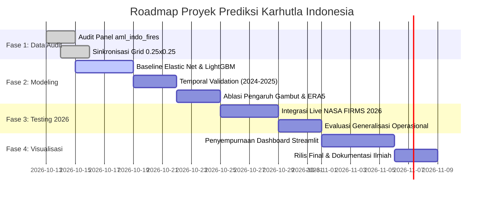

# 📄 PRODUCT REQUIREMENTS DOCUMENT (PRD)

---

## 📌 Dokumen Metadata
* **Nama Proyek:** Sistem Prediksi Spatiotemporal Karhutla Indonesia Berbasis Hotspot dan Cuaca (*IndoWildfire-AI*)
* **Versi Dokumen:** v1.0.0
* **Status:** Disetujui untuk Implementasi (*Ready for Implementation*)
* **Dataset Utama:** **Indonesian Wildfire Panel Dataset (2012–2025)** (`data/aml_indo_fires`)
* **Cakupan Spasial:** Seluruh Lanskap Sumatera & Kalimantan (Resolusi Sel Grid 0.25° × 0.25°)
* **Cakupan Temporal:** Januari 2012 – Desember 2025 (168 Bulan / Rentang Panel Penuh) + Uji Operasional 2026

---

## 🎯 1. Ringkasan Eksekutif & Latar Belakang (Executive Summary & Background)

### 1.1 Masalah (Problem Statement)
Kebakaran Hutan dan Lahan (*Karhutla*) di Indonesia—terutama pada ekosistem lahan gambut tropis di Sumatera dan Kalimantan—merupakan bencana tahunan multisektoral yang menimbulkan emisi gas rumah kaca berskala gigaton, krisis kesehatan akibat kabut asap transboundary (*ISPA*), serta kerugian ekonomi makro bernilai puluhan triliun rupiah. 

Pendekatan konvensional yang semata-mata mengandalkan deteksi titik panas (*active fire detection* real-time) memiliki kelemahan mendasar: **bersifat reaktif**. Ketika anomali termal terdeteksi oleh sensor satelit, api pada lapisan gambut dalam sering kali telah mencapai tahap pembakaran membara (*smoldering combustion*) yang sangat sulit dipadamkan dan membutuhkan jutaan liter air serta intervensi *water bombing*.

### 1.2 Solusi Produk (Product Vision)
Membangun platform sistem peringatan dini prediktif (*Early-Onset Predictive Wildfire Intelligence*) berbasis *Machine Learning* yang memadukan rekam jejak anomali termal historis satelit (NASA FIRMS / VIIRS) dan dinamika atmosfer reanalisis (ECMWF ERA5-Land) bersama atribut biofisik lahan gambut. Sistem bertransisi dari **pemantauan pasif** menjadi **prediksi spasial proaktif**, memperkirakan probabilitas kemunculan kebakaran (*Fire Ignition & Spread Probability*) pada horizon 1 hingga 3 bulan ke depan per sel grid.

---

## 👥 2. Pemangku Kepentingan & Target Pengguna (User Personas & Stakeholders)

1. **Tim Patroli Lapangan & Manggala Agni (KLHK / BPBD):**
   * *Kebutuhan:* Peta risiko spasial probabilitas tinggi untuk memprioritaskan jadwal dan rute patroli darat serta inspeksi sekat kanal (*canal blocking*) sebelum puncak musim kering.
2. **Analis Geospasial & Peneliti Iklim:**
   * *Kebutuhan:* Akses ke fitur panel terstandardisasi, pengujian model klasifikasi/regresi, dan visualisasi hubungan kausalitas cuaca terhadap kekeringan gambut.
3. **Pengambil Kebijakan / Badan Nasional Penanggulangan Bencana (BNPB):**
   * *Kebutuhan:* Ringkasan risiko bulanan tingkat provinsi/kabupaten dan proyeksi mitigasi kerugian ekonomi untuk alokasi anggaran tanggap darurat.

---

## 📊 3. Spesifikasi Dataset & Sumber Daya Data (Data Architecture)

Sistem menggunakan fondasi primer **Indonesian Wildfire Panel Dataset (2012–2025)** yang telah diproses dalam format Apache Parquet performa tinggi:

### 3.1 Spesifikasi Spatiotemporal
* **Grid Spasial:** Grid sel reguler 0.25° × 0.25° (~27.75 km × 27.75 km pada ekuator), diselaraskan dengan grid reanalisis ECMWF ERA5.
* **Cakupan Wilayah:**
  * **Sumatera:** 94.0°E – 106.5°E, 6.5°S – 6.5°N.
  * **Kalimantan:** 108.0°E – 119.5°E, 5.0°S – 8.5°N.
  * **Total Sel Daratan:** ~1,839 sel darat (sel laut telah difilter).
* **Resolusi Waktu:** Bulanan (*monthly panel aggregate*), 168 langkah waktu (Januari 2012 s.d. Desember 2025).

### 3.2 Lapisan Data & Fitur (Feature Taxonomy)
Data diorganisasi dalam 5 tingkat file terkurasi di `data/aml_indo_fires/`:

```
data/aml_indo_fires/
├── panel_core_2012_2025.parquet             # Core aggregate: fire counts + ERA5 + static
├── panel_eda_enriched_2012_2025.parquet     # Lag variables, drought proxies, spatial neighbors
├── static_cell_features_2012_2025.parquet   # Static per-cell: Peat, Concessions, Roads, GADM
├── modelling_data_linear_2012_2025.parquet  # Linear models (Elastic Net) + interaction terms
└── modelling_data_nonlinear_2012_2025.parquet # Tree-based models (LightGBM, XGBoost, CatBoost)
```

#### Taksonomi Fitur:
1. **Fitur Target Kebakaran (*Ground Truth Labels*):**
   * `fire_count`: Jumlah deteksi hotspot satelit VIIRS SNPP 375m per sel per bulan.
   * `fire_binary`: Target klasifikasi biner (`1` jika `fire_count >= threshold`, `0` jika nihil).
   * `fire_next_1m` & `fire_next_3m`: Target prediktif lead forward tanpa kebocoran waktu.
2. **Fitur Meteorologi & Reanalisis (ERA5 / ERA5-Land):**
   * `temperature_2m` (°C): Rerata dan nilai ekstrem suhu udara permukaan.
   * `precipitation` (mm/hari): Akumulasi curah hujan bulanan.
   * `relative_humidity_2m` (%): Kelembapan relatif permukaan.
   * `soil_moisture` ($m^3/m^3$): Kelembapan volumetrik tanah lapisan atas (0–7 cm) dan lapisan dalam (7–28 cm).
   * `drought_proxies`: Standardized Precipitation Index (*SPI*), hari tanpa hujan konsekutif (*CDD*).
3. **Fitur Temporal & Lagging (Dynamic Memory):**
   * Lag curah hujan ($t-1, t-2, t-3$ bulan): Mengukur akumulasi pengeringan kubah gambut.
   * Lag hotspot ($t-1, t-12$): Siklus tahunan dan persistensi api.
4. **Fitur Statis Lingkungan & Antropogenik:**
   * `peatland_fraction`: Proporsi tutupan Kesatuan Hidrologis Gambut (KHG).
   * `concession_fraction`: Proporsi izin konsesi kelapa sawit & HTI (hutan tanaman industri).
   * `distance_to_road`: Jarak terdekat ke infrastruktur jalan (proksi aksesibilitas perambahan).

---

## 🤖 4. Desain Pemodelan Machine Learning (Modeling & Architecture)

### 4.1 Formulasi Masalah (Problem Formulation)
* **Tugas Utama 1 (Klasifikasi Risiko Spasial):** Memprediksi probabilitas bersyarat $P(\text{Fire}_{i, t+1} = 1 \mid X_{i, t})$ pada sel $i$ untuk bulan $t+1$.
* **Tugas Utama 2 (Regresi Intensitas / Spreading):** Mengestimasi logaritma magnitudo hotspot $\log(1 + \text{fire\_count}_{i, t+1})$.

### 4.2 Strategi Pembagian Data (Temporal Validation Protocol)
Untuk mencegah kebocoran informasi masa depan (*data leakage*) dan spatial autocorrelation leakage:
* **Training Set:** 2012 – 2022 (11 Tahun Data Historis / ~132 Bulan).
* **Validation Set (Hyperparameter Tuning):** 2023 (Tahun El-Niño moderat).
* **Out-of-Time Test Set:** 2024 – 2025 (24 Bulan Terakhir untuk benchmark performa tidak terdistorsi).
* **Operasional Inference Test:** 2026 (Data near real-time NASA FIRMS & Open-Meteo).

### 4.3 Model Benchmark & Algoritma
1. **Baseline Teratur Linier:** Elastic Net Logistic Regression (dengan 14 interaction terms dan *L1/L2 regularization*).
2. **Model Pohon Non-Linier Utama:** **LightGBM Classifier** (mengoptimalkan penanganan fitur kategorikal provinsi/bulan dan komputasi histogram berkecepatan tinggi).
3. **Challenger Models:** XGBoost Classifier dengan skala bobot `scale_pos_weight` untuk mengatasi ketidakseimbangan kelas (*class imbalance*).

---

## 📈 5. Metrik Keberhasilan & Evaluasi (Evaluation Metrics & Success Criteria)

Karena kejadian kebakaran hutan merupakan peristiwa jarang (*imbalanced rare event* / positive class < 10%):

| Metrik | Target Keberhasilan (Threshold) | Rasionalisasi Ilmiah |
| :--- | :--- | :--- |
| **PR-AUC (Average Precision)** | **≥ 0.65** | Metrik primer terpenting untuk dataset imbalanced; mengukur trade-off precision vs recall tanpa bias true negative berlebih. |
| **ROC-AUC** | **≥ 0.85** | Mengukur kemampuan diskriminasi global model terhadap sel berisiko vs sel aman. |
| **Recall @ Top 20% Risk Grid** | **≥ 80.0%** | Memastikan minimal 80% dari seluruh kejadian karhutla aktual berhasil ditangkap dalam 20% sel dengan ranking risiko tertinggi. |
| **Brier Score (Kalibrasi)** | **≤ 0.08** | Menjamin bahwa nilai probabilitas yang dihasilkan model mencerminkan frekuensi empiris sebenarnya (terkalibrasi baik). |
| **Log-Loss** | **Menurun dibanding Baseline** | Mengukur penalti kesalahan ketidakpastian prediksi probabilitas. |

---

## 💻 6. Persyaratan Fungsional Produk (Functional Requirements)

### FR-1: Pipeline Ingest & Sinkronisasi Panel
* Sistem harus mampu membaca dan memvalidasi file parquet panel `data/aml_indo_fires/` dalam waktu $< 5$ detik.
* Sistem harus mendukung penyatuan data operasional tahun 2026 dari API NASA FIRMS dan Open-Meteo ERA5-Land.

### FR-2: Feature Engineering & Preprocessing Otomatis
* Penanganan nilai hilang (*missing values*) berbasis interpolasi spasial tetangga terdekat (*KNN Imputer*).
* Ekstraksi otomatis lag 1, 2, dan 3 bulan untuk fitur kelembapan tanah dan curah hujan.

### FR-3: Mesin Inferensi & Peringkat Risiko (Risk Scoring Engine)
* Menghasilkan skor indeks bahaya 0–100 yang terbagi ke dalam 4 kategori standar:
  * **Rendah (0–30):** Hijau
  * **Waspada (31–60):** Kuning
  * **Siaga (61–80):** Oranye
  * **Kritis / Ekstrem (>80):** Merah

### FR-4: Visualisasi Interaktif & Dashboard Terintegrasi
* Integrasi peta tematik interaktif (Leaflet / Folium) yang menampilkan poligon sel grid 0.25°, sebaran kubah gambut (KHG), dan batas administrasi provinsi.
* Tab komparasi skenario mitigasi kerugian ekonomi makro dan dampak kesehatan masyarakat (*ISPA*).

---

## ⚙️ 7. Persyaratan Non-Fungsional (Non-Functional Requirements)

1. **Performa & Latensi:** Inferensi prediktif untuk seluruh 1,839 sel grid Sumatera dan Kalimantan harus selesai dalam waktu $< 2$ detik.
2. **Reproduksibilitas Ilmiah:** Seluruh eksperimen, hyperparameter seed, dan skema validasi waktu harus terdokumentasi dalam notebook dan skrip Python yang dapat diaudit secara independen.
3. **Efisiensi Memori:** Penggunaan format Parquet terkompresi Snappy untuk memastikan pemrosesan panel 2012–2025 dapat berjalan pada memori RAM standar (≤ 8 GB).
4. **Keamanan & Kredensial:** API Key eksternal (NASA FIRMS, Hugging Face) dikelola melalui *Environment Variables*, tidak boleh di-hardcode ke repositori publik.

---

## 🗓️ 8. Rencana Implementasi & Roadmap (Execution Milestones)



---

## 📚 9. Standar Atribusi & Lisensi Data
* **Dataset Panel:** CC BY 4.0 (*Indonesian Wildfire Panel Dataset 2012–2025*, jq5522).
* **Data Primer Satelit:** NASA EOSDIS LANCE FIRMS (Atribusi publik NASA).
* **Data Reanalisis Cuaca:** ECMWF ERA5 / Open-Meteo API (Lisensi Copernicus / CC BY 4.0).
* **Batas Wilayah & Konsensi:** Badan Informasi Geospasial (BIG) & GADM v1.
