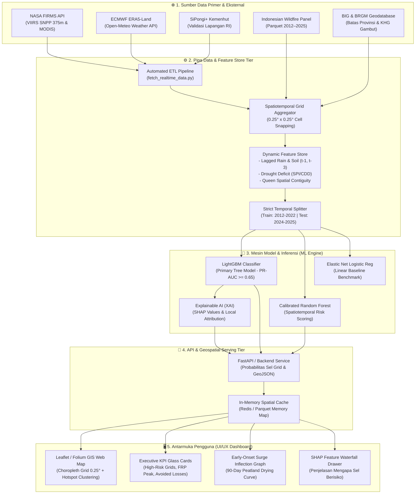
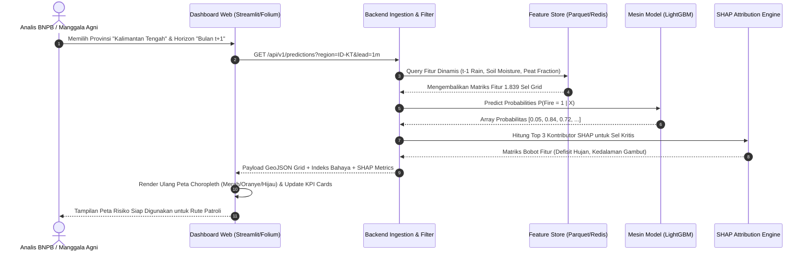

# 🎨 SYSTEM ARCHITECTURE & UI/UX DESIGN SPECIFICATION
### *Sistem Intelijen Prediksi Spatiotemporal Karhutla Indonesia (IndoWildfire-AI)*

---

## 🏛️ 1. Arsitektur Sistem Menyeluruh (System Architecture & C4 Model)



---

## 🎨 2. Sistem Desain Antarmuka (Design System & Visual Aesthetics)

Antarmuka dirancang dengan standar **Premium Mission-Control Dashboard** bertema *Dark Mode* terkurasi, menggunakan efek *Glassmorphism*, palet warna lingkungan presisi tinggi, dan kontras visual yang tajam untuk ruang kendali darurat bencana.

### 2.1 Palet Warna Tematik (*Design Tokens*)

| Token Warna | Nilai HEX / HSL | Penggunaan & Makna Psikologis |
| :--- | :--- | :--- |
| **`bg-canvas`** | `#080C14` | Latar belakang dasar (*Deep Obsidian Night*). |
| **`bg-surface`** | `rgba(17, 24, 39, 0.75)` | Kartu glassmorphism dengan efek blur latar (*backdrop-blur-md*). |
| **`border-subtle`**| `rgba(255, 255, 255, 0.08)`| Garis batas halus semi-transparan untuk pemisahan komponen. |
| **`risk-critical`**| `#EF4444` *(Red 500)* | Sel grid bahaya ekstrem (*P > 0.75*, asap tebal, kebakaran aktif). |
| **`risk-high`**    | `#F97316` *(Orange 500)*| Sel grid siaga (*P: 0.50 - 0.75*, kubah gambut mengering kritis). |
| **`risk-moderate`**| `#F59E0B` *(Amber 500)* | Sel grid waspada (*P: 0.25 - 0.50*, hari tanpa hujan > 14 hari). |
| **`risk-low`**     | `#10B981` *(Emerald 500)*| Sel grid aman (*P < 0.25*, kelembapan tanah basah normal). |
| **`brand-accent`** | `#38BDF8` *(Sky 400)* | Sorotan tombol, slider horizon waktu, dan link interaktif. |
| **`text-primary`** | `#F8FAFC` *(Slate 50)* | Tipografi judul dan nilai metrik utama (kontras tajam). |
| **`text-muted`**   | `#94A3B8` *(Slate 400)*| Keterangan teks sekunder dan label unit. |

### 2.2 Tipografi
* **Font Utama:** `Inter`, `system-ui`, `-apple-system` (Kejelasan pembacaan angka dan label koordinat).
* **Font Angka / Data Metrik:** `JetBrains Mono` / `SF Mono` (Untuk latensi, nilai FRP MW, dan koordinat lat/lon).

---

## 🖥️ 3. Wireframe & Tata Letak Dashboard (Dashboard Layout Wireframe)

Tata letak mengadopsi struktur 3-kolom adaptif (*Mission-Control Grid Layout*):

```
+----------------------------------------------------------------------------------------------------+
|  [Logo 🔥 IndoWildfire-AI]   Peringatan Dini Spatiotemporal Karhutla RI   | Status: LIVE (2026 Sync) |
+----------------------------------------------------------------------------------------------------+
|  KONTROL PANEL ATAS:                                                                               |
|  [Wilayah: Sumatera & Kalimantan v] [Model: LightGBM v1.0 v] [Horizon: +1 Bulan / Sep 2026 [=====o-]] |
+----------------------------------------------------------------------------------------------------+
| [ KOLOM KIRI (25%) ]       | [ KANVAS PETA TENGAH (50%) ]            | [ KOLOM KANAN (25%) ]        |
|                            |                                         |                              |
| 1. Kartu Ringkasan KPI:    | PETA GEOSPASIAL INTERAKTIF (LEAFLET):   | 3. Analisis Prediksi & XAI:  |
|   - Sel Berisiko Kritis:   | - Layer 1: Grid Probabilitas 0.25°      |   - SHAP Waterfall Plot:     |
|     142 Sel (8.2%)         |   (Choropleth Merah-Kuning-Hijau)       |     * tp_deficit_3m: +0.28   |
|   - Titik Api Aktif VIIRS: | - Layer 2: Poligon Kubah Gambut (KHG)   |     * peat_fraction: +0.19   |
|     1.240 Deteksi          | - Layer 3: Klaster Hotspot Real-time    |     * soil_moist:    +0.14   |
|   - Proyeksi Kerugian:     | - Layer 4: Arah Angin & Sebaran Asap    |                              |
|     IDR 44.2 Triliun       |                                         | 4. Kurva 90 Hari Infleksi:   |
|                            | Tooltip Klik Sel:                       |   [Grafik Garis Lonjakan Api]|
| 2. Pemicu Iklim Dinamis:   |   * Cell ID: cell_-02.25_113.75         |   * Titik Tipping Point:     |
|   - El-Nino Status: Positif|   * Probabilitas: 84.6% (KRITIS)        |     Minggu ke-2 Juli         |
|   - Anomali Hujan: -42 mm  |   * Gambut: Kahayan-Sebangau (88%)      |   * Rekomendasi Aksi:        |
|   - Kelembapan Gambut:     |   * Curah Hujan Lag-1: 1.2 mm           |     Sekat Kanal Sebelum 15Jul|
|     0.18 m3/m3 (Kering)    |                                         |                              |
+----------------------------------------------------------------------------------------------------+
| TABEL MONITORING BAWAH (Collapsible):                                                              |
| [10 Sel Paling Berbahaya] | [Verifikasi Akurasi Out-of-Time] | [Ekspor Laporan PDF/GeoJSON]        |
+----------------------------------------------------------------------------------------------------+
```

---

## 🔄 4. Diagram Alir Data & Interaksi Pengguna (Sequence Diagram)

Alur kerja interaksi saat pengguna mengubah slider horizon prediksi waktu (*Lead Time Slider*):



---

## 🧩 5. Desain Komponen Antarmuka Utama (Component Breakdown)

### 5.1 Komponen 1: Peta Kanvas Spasial Terintegrasi (*Interactive GIS Canvas*)
* **Teknologi:** Folium / Leaflet dengan dukungan WebGL vector rendering.
* **Fitur Utama:**
  * **Layer Switcher:** Pilihan basemap (*Dark Matter CartoDB*, *Esri Satellite World Imagery*, *OpenStreetMap*).
  * **Grid Choropleth Overlay:** Polygon 0.25° berpewarnaan gradien kontinu sesuai probabilitas $P(\text{Fire} = 1)$.
  * **Batas Kubah Gambut (KHG):** Garis batas putus-putus berwarna cyan berpendar (*glowing cyan border*) menandai kedalaman gambut > 3 meter.
  * **Marker Clustering:** Pengelompokan titik api satelit FIRMS real-time dengan angka radiasi FRP (Megawatt).

### 5.2 Komponen 2: Panel Penjelasan Keputusan Model (*Explainable AI Drawer*)
* **Tujuan:** Menghilangkan persepsi *Black-Box* pada algoritma *Machine Learning*.
* **Tampilan:** Setiap kali pengguna mengklik salah satu sel grid yang berstatus **KRITIS**, muncul drawer samping berisi grafik batang kontribusi lokal SHAP:
  * $\Delta P = +28\%$ didorong oleh defisit curah hujan 3 bulan berturut-turut.
  * $\Delta P = +19\%$ didorong oleh keberadaan lapisan gambut tebal (>80% luas sel).
  * $\Delta P = -5\%$ diredam oleh jarak sel yang relatif jauh dari akses jalan perambahan.

### 5.3 Komponen 3: Kalkulator Valuasi Mitigasi Bencana (*Disaster Econometrics ROI Card*)
* **Metrik Komparatif:**
  * **Skenario Tanpa Mitigasi (*Status Quo*):** Menampilkan estimasi kerugian makro terproyeksi (Rp 449,38 Triliun) yang mencakup hilangnya stok karbon, gangguan penerbangan, penutupan sekolah, dan biaya rawat inap ISPA.
  * **Skenario Intervensi Terintegrasi (*Proactive Mitigation*):** Menghitung nilai kerugian yang dapat dicegah (Rp 390,00 Triliun) dengan rasio efektivitas biaya (*Benefit-Cost Ratio*) sebesar **58,35x**.

---

## 📱 6. Desain Responsif & Kinerja (Responsive & Performance Design)

1. **Rendering Peta Cepat:** Sel grid disajikan menggunakan format GeoJSON terkompresi berbasis TopoJSON atau FlatGeobuf, memangkas ukuran transfer data dari 25 MB menjadi $< 1.8 \text{ MB}$.
2. **Dukungan Multi-Perangkat:**
   * **Desktop (1920×1080 / 1440×900):** Tampilan penuh 3-kolom untuk pusat komando dan ruang kendali darurat.
   * **Tablet / Lapangan (1024×768):** Kolom samping dapat disembunyikan (*collapsible sidebar*), memprioritaskan peta interaktif untuk inspeksi tim lapangan Manggala Agni.
